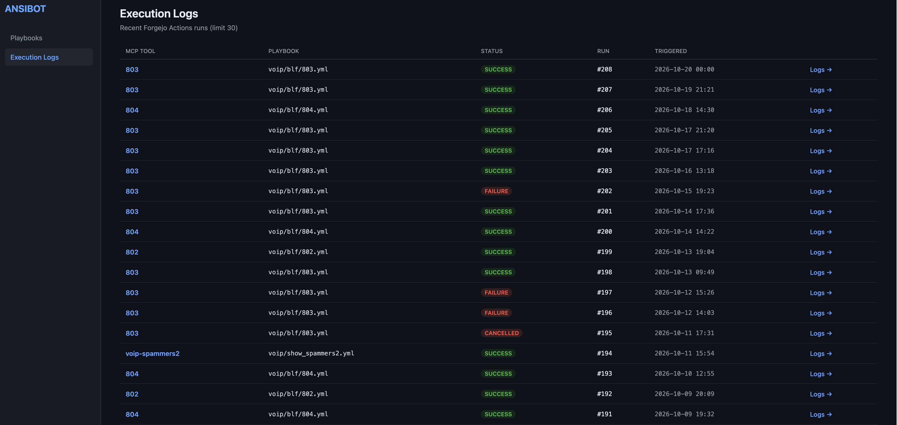
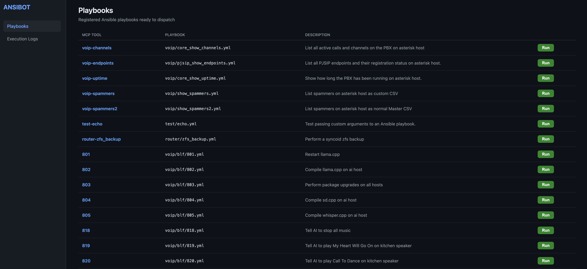

# ansibot

Forgejo + Ansible Playbooks + MCP server + Simple WebUI ( FreeBSD Tested )

**Ansibot** is an ultra-lightweight, zero-bloat alternative to heavy enterprise automation platforms like Red Hat Ansible Automation Platform (AAP) or Semaphore UI. Built for homelabs and developer environments, it bridges local AI models and infrastructure orchestration directly via the Model Context Protocol (MCP)—giving you fast, programmatic control over your playbooks without the heavy web-UI tax.

I made this for a simple problem that existed, there was currently no simple bridge between ansible-playbooks and your Forgejo Runner. I wanted a simple daemon,
not a bloated docker/podman container, a simple system service just like forgejo and runners.

## Core Design Philosophy

1. **Forgejo-Powered Execution:** Ansibot does not reinvent execution engines. It leverages proven runners (`act_runner`) written in Go to execute and log Ansible playbooks on your own terms via `.forgejo/workflows/playbook.yml`.
2. **Unified Configuration (`ansibot.conf`):** Everything is defined in a single configuration file—your MCP server settings, Forgejo credentials, and explicit MCP tool definitions mapping directly to your playbooks.
3. **Frictionless Bootstrapping:** On startup, Ansibot automatically verifies and pushes the required workflow definitions (`playbook.yml`) to your Forgejo repository if they do not already exist or have been updated locally.
4. **Read-Only Dashboard:** The WebUI exercises zero control over your infrastructure; it exists solely to display configured playbooks and provide deep links to completed run logs directly on your Forgejo server. WebUI allows you to run playbooks and view logs only.
5. **State Enforced via Restarts:** To ensure connected AI clients safely re-evaluate available tools and configurations, all state updates rely on an explicit service lifecycle restart (`service ansibot restart`).





## Workflow

1. Drop a new playbook into your setup.
2. Update `ansibot.conf` to map a new MCP tool name to the playbook.
3. Restart the service (`service ansibot restart`) to sync workflows to Forgejo and expose the updated tools to your AI clients.


# FreeBSD Setup

## Install forgejo and act_runner
```
pkg install forgejo forgejo-act_runner
nano /usr/local/etc/forgejo/conf/app.ini
sysrc forgejo_enable="YES"
service forgejo start (go get a token for act_runner on webUI)
nano /usr/local/etc/act_runner/act_runner.conf
sysrc act_runner_enable="YES"
service act_runner start
```
* Verify act_runner is connected to forgejo

## Install Ansible + Ansibot
```
pkg install python314 bash
chsh -s /usr/local/bin/bash act_runner
su - act_runner
git clone https://github.com/crystalsighting/ansibot.git
export CPPFLAGS="-I/usr/local/include"
export LDFLAGS="-L/usr/local/lib"
export PKG_CONFIG_PATH="/usr/local/libdata/pkgconfig:${PKG_CONFIG_PATH:-}"
python3.14 -m venv .venv
.venv/bin/pip install --upgrade pip
.venv/bin/pip install -r ansibot/requirements.txt
(as root)
mkdir -p /usr/local/etc/ansibot
cp ansibot/startup-scripts/freebsd/ansibot /usr/local/etc/rc.d
cp ansibot/startup-scripts/freebsd/ansibot.conf /usr/local/etc/ansibot
cp ansibot/startup-scripts/freebsd/bash_profile ~/.bash_profile
cp ansibot/startup-scripts/playbook.yml /usr/local/etc/ansibot
cp -rp ansibot/bin ~
cp -rp ansibot/playbooks ~
cd /usr/local/etc/ansibot
nano ansible.conf
nano playbook.yml
```

## Add to system startup
```
sysrc ansibot_enable="YES"
sysrc ansibot_python="/var/db/act_runner/.venv/bin/python"
service ansibot start
```
* Visit ansibot WebUI

## Add logging
```
cp ansibot/startup-scripts/freebsd/syslog/ansibot.conf /etc/syslog.d
service syslogd restart
```
* This will allow you to tail /var/log/ansibot/tools.log to see just tool calls for audit trail.

## Upgrading
```
su - act_runner
.venv/bin/pip install --upgrade -r requirements.txt
```
## Directory Structure
* ansibot/startup-scripts        — FreeBSD and Linux startup scripts
* ansibot/bin/ansibot            — ansibot
* ansibot/nginx                  — Example nginx config to secure forgejo and ansibot

## AI llama.cpp integration example:
* cargo install mcp-stdio-proxy
```
    "ansible-playbooks": {
      "command": "/home/ollama/.cargo/bin/mcp-proxy",
      "args": [
        "convert",
        "https://ansibot.example.com/mcp",
        "--auth",
        "Bearer mytoken"
      ]
    },
```

## SSH keys
```
su - act_runner 
ssh-keygen -t ed25519 -f ~/.ssh/id_ed25519 -N "" 
```
* Stick your ~/.ssh/id_ed25519.pub contents into .ssh/authorized_keys on all target servers

## Example workflow
```
su - act_runner
cd playbooks
nano hosts OR ansible.cfg OR someplaybook (to work with playbooks)
(as root)
nano /usr/local/etc/ansibot.conf ( add your playbook to MCP list)
service ansibot restart
```
